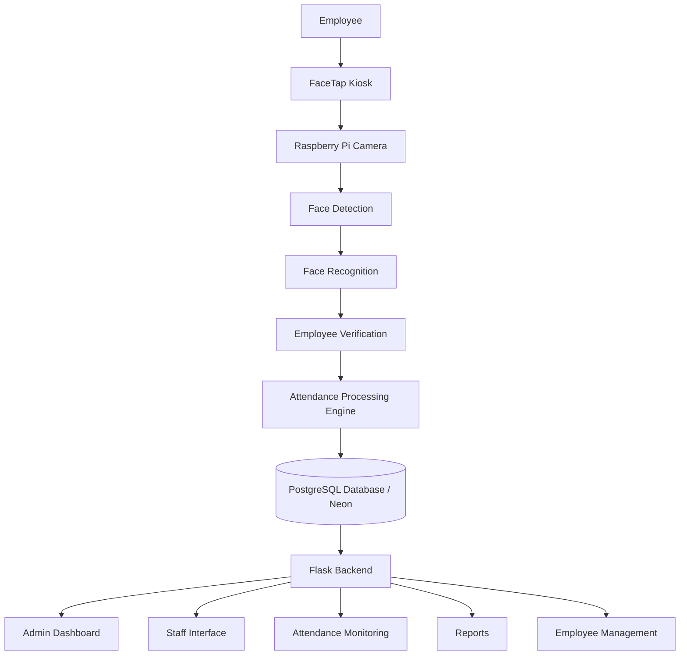

<div align="center">

# FaceTap

### Facial Recognition Attendance Management System


FaceTap is a facial recognition-based attendance system built to automate employee attendance, simplify workforce monitoring, and provide centralized attendance management through a Raspberry Pi kiosk and web application.

</div>

> **This repository contains public documentation for FaceTap only. The application source code is maintained separately in a private repository.**
>
> Public access to this documentation does not grant access to, or permission to reuse, the private FaceTap source code.

---

## About FaceTap

FaceTap is an attendance management system that uses facial recognition to identify registered employees and automatically process their attendance.

The system combines a Raspberry Pi-based kiosk, camera-based face recognition, a Flask backend, a PostgreSQL database, and a web-based administration dashboard.

Instead of relying only on traditional attendance methods such as logbooks, ID scanning, or manual encoding, FaceTap allows registered employees to record their attendance through facial recognition.

The system is designed to manage the full attendance workflow, including employee records, schedules, time-in and time-out, leave records, attendance status, monitoring, and reporting.

---

## Main Features

FaceTap includes functionality for:

- Facial recognition attendance
- Employee time-in and time-out
- Raspberry Pi attendance kiosk
- Raspberry Pi Camera Module integration
- Face registration
- Employee management
- Attendance monitoring
- Attendance history
- Schedule management
- AM and PM schedules
- Leave management
- Official Business records
- Sick Leave records
- Attendance status management
- Daily attendance processing
- Required working hours
- Attendance reports
- Administrative dashboard
- Staff access
- Role-based system access
- Automated attendance notifications
- Remote kiosk management
- Responsive web interface
- PostgreSQL database integration
- Cloud database hosting through Neon

---

## How FaceTap Works

The employee uses the FaceTap kiosk to record attendance.

The general process is:

```text
Employee
   ↓
Raspberry Pi Camera
   ↓
Face Detection
   ↓
Face Recognition
   ↓
Employee Identification
   ↓
Schedule and Attendance Validation
   ↓
Time-In / Time-Out Processing
   ↓
PostgreSQL Database
   ↓
Dashboard / Monitoring / Reports
```

When a face is detected, FaceTap attempts to identify the employee using their registered facial data.

After a successful match, the system checks the employee's current attendance record, assigned schedule, time, and attendance rules before determining the correct action.

Depending on the current attendance state, FaceTap can process actions such as time-in or time-out while preventing unnecessary duplicate records.

---

## System Components

FaceTap consists of several connected components.

### Raspberry Pi Kiosk

The kiosk acts as the physical attendance terminal.

It is responsible for:

- Camera access
- Face detection
- Face recognition
- Employee identification
- Attendance requests
- Attendance confirmation
- Kiosk notifications
- Real-time attendance interaction

Typical kiosk hardware includes:

- Raspberry Pi 4
- Raspberry Pi Camera Module
- Display
- Raspberry Pi power supply
- Cooling system or heatsink
- Network connection
- Custom enclosure

---

### Web Application

The FaceTap web application provides the management side of the system.

Authorized users can use the web application to manage:

- Employees
- Attendance records
- Schedules
- Leave records
- Attendance statuses
- Reports
- User accounts
- System configuration
- Kiosk-related functions

The web application communicates with the database and provides centralized access to attendance information.

---

### Database

FaceTap uses PostgreSQL as its relational database.

The current database is hosted using Neon.

The database stores system information such as:

- Employee records
- Attendance logs
- User accounts
- Schedules
- Leave information
- Attendance statuses
- Application configuration
- Historical records

---

## Programming Languages

FaceTap uses several programming languages across its backend, frontend, and device interfaces.

### Python


Python is used primarily for:

- Backend application logic
- Flask web application
- Facial recognition processing
- Camera integration
- Attendance processing
- Database operations
- Raspberry Pi functionality
- Automation
- Server-side validation

---

### JavaScript


JavaScript is used for frontend functionality such as:

- User interactions
- Dynamic dashboard components
- Forms
- Interface behavior
- Asynchronous requests
- Kiosk interactions
- Responsive frontend features

---

### HTML


HTML provides the structure of the FaceTap web interface, including:

- Dashboard pages
- Forms
- Employee management views
- Attendance interfaces
- Reports
- Kiosk pages

---

### CSS


CSS is used for:

- Layout
- Responsive design
- Dashboard styling
- Kiosk interface styling
- Components
- Animations
- Visual consistency

---

### SQL


SQL is used for interacting with the PostgreSQL database.

It supports operations related to:

- Employees
- Attendance
- Schedules
- Leave records
- Accounts
- Reports
- Application data

---

## Technology Stack

| Area | Technology |
| --- | --- |
| Backend | Python |
| Web Framework | Flask |
| Frontend | HTML, CSS, JavaScript |
| Database | PostgreSQL |
| Database Platform | Neon |
| Facial Recognition | Python-based computer vision |
| Hardware Platform | Raspberry Pi |
| Camera | Raspberry Pi Camera Module |
| Version Control | Git |
| Repository Hosting | GitHub |
| Networking / Deployment | Cloudflare |
| Web Interface | Flask + HTML/CSS/JavaScript |

---

## System Architecture



---

## Facial Recognition

FaceTap uses facial recognition to identify registered employees during attendance scanning.

A simplified recognition pipeline is:

```text
Camera Frame
    ↓
Face Detection
    ↓
Face Processing
    ↓
Feature Extraction
    ↓
Face Comparison
    ↓
Employee Match
    ↓
Attendance Validation
```

The recognition system works together with attendance validation rather than immediately creating an attendance record after every detected face.

Face recognition accuracy can be affected by environmental conditions such as:

- Lighting
- Camera angle
- Distance
- Motion
- Image quality
- Facial obstruction

---

## Attendance Processing

After an employee is recognized, FaceTap checks the attendance context before saving a record.

The system may evaluate:

- Employee identity
- Current date
- Current time
- Existing attendance records
- Assigned schedule
- Morning schedule
- Afternoon schedule
- Required hours
- Previous time-in
- Previous time-out
- Leave status
- Attendance status

This allows the system to determine the appropriate attendance action.

---

## Employee Management

Authorized users can manage employee information through the web application.

Employee records may include:

- Employee ID
- Name
- Department
- Position
- Employment status
- Schedule
- Facial registration information
- Attendance history

FaceTap also supports managing employee attendance-related information from a centralized interface.

---

## Schedule Management

FaceTap supports employee scheduling.

Schedules can be configured based on organizational requirements and may include:

- AM schedule
- PM schedule
- Full-day schedule
- Required hours
- Time-in period
- Time-out period

These schedules are used during attendance processing.

---

## Leave Management

FaceTap supports different attendance and leave classifications.

Examples include:

- Present
- Late
- Absent
- Official Business
- Sick Leave
- Other configured leave types

Authorized staff can update employee attendance statuses according to organizational policies.

---

## Reports

FaceTap can provide attendance information for reporting and monitoring.

Reports may contain:

- Daily attendance
- Time-in records
- Time-out records
- Employee attendance history
- Late records
- Absence records
- Leave records
- Schedule-based attendance information

---

## Dashboard

The dashboard provides a centralized overview of FaceTap activity.

Depending on permissions, users may have access to:

- Attendance statistics
- Employee information
- Recent attendance
- Attendance records
- Schedules
- Leave information
- Reports
- System settings
- User management

---

## User Roles

FaceTap uses role-based access to separate system responsibilities.

Current system roles may include:

- Admin
- Staff
- Kiosk

Each role is provided only with the functionality required for its intended purpose.

---

## Security

FaceTap includes security considerations across the application, database, and deployment layers.

These include:

- Authentication
- Authorization
- Role-based access
- Session management
- Protected application routes
- Environment variable management
- Database credential protection
- Server-side validation
- Secure deployment configuration

Sensitive information such as passwords, API keys, database credentials, connection strings, and deployment secrets are not stored in this public repository.

---

## Privacy

Because FaceTap works with employee and facial information, biometric data should be handled carefully.

Important considerations include:

- Restricted biometric data access
- Employee authorization and consent
- Secure storage
- Appropriate data retention
- Restricted administrator access
- Secure backups
- Responsible use of facial recognition

The system should be deployed according to the policies and privacy requirements of the organization using it.

---

## Hardware

The current FaceTap kiosk setup may include:

| Component | Purpose |
| --- | --- |
| Raspberry Pi 4 | Main kiosk computer |
| Raspberry Pi Camera Module | Face capture |
| Display | Kiosk interface |
| Heatsink / Cooling | Raspberry Pi thermal management |
| Network Connection | Server/database communication |
| Power Supply | Kiosk power |
| Enclosure | Physical kiosk housing |

---

## Repository Structure

This repository contains FaceTap project documentation and public project information.

```text
FaceTap/
├── README.md
├── LICENSE
├── .gitignore
├── assets/
├── docs/
└── screenshots/
```

---

## Screenshots

System screenshots can be stored in:

```text
screenshots/
```

Examples:

```text
dashboard.png
kiosk.png
employee-management.png
attendance-monitoring.png
schedule-management.png
reports.png
```

---

## Documentation

More detailed documentation can be stored inside:

```text
docs/
```

Recommended documentation includes:

```text
docs/
├── system-overview.md
├── features.md
├── system-architecture.md
├── hardware-requirements.md
├── software-requirements.md
├── installation-overview.md
├── security-and-privacy.md
└── project-status.md
```

---

## Development Status


FaceTap is currently under active development.

Current areas of development and improvement include:

- Facial recognition reliability
- Attendance processing accuracy
- Camera performance
- Raspberry Pi performance
- Kiosk experience
- Responsive user interface
- Dashboard improvements
- Database reliability
- Attendance reports
- Security improvements
- Remote kiosk management
- Hardware integration

---

## Current Platform

FaceTap currently uses:

```text
Python
Flask
HTML
CSS
JavaScript
PostgreSQL
Neon
Raspberry Pi
Raspberry Pi Camera
Git
GitHub
Cloudflare
```

---

## Repository Notice


This repository provides public information and documentation about FaceTap.

The production application, deployment configuration, credentials, and internal implementation are maintained separately.

---

<div align="center">

### FaceTap

Facial Recognition Attendance Management System

`Python` • `Flask` • `JavaScript` • `PostgreSQL` • `Neon` • `Raspberry Pi`

</div>
