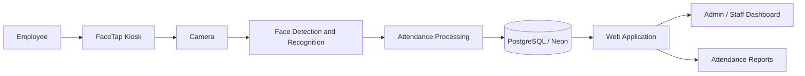

# FaceTap

> **This repository contains public documentation for FaceTap only. The application source code is maintained separately in a private repository.**
>
> Public access to this documentation does not grant access to, or permission to reuse, the private FaceTap source code.

FaceTap is a facial recognition-based attendance system designed to make employee attendance recording faster, more convenient, and easier to manage.

The system combines facial recognition, attendance processing, Raspberry Pi hardware, and a web-based management interface to provide a more automated alternative to traditional attendance methods.

## About the Project

FaceTap was developed as an attendance and monitoring system that allows employees to record their attendance using facial recognition.

The system is designed to reduce manual attendance encoding, simplify attendance monitoring, and provide administrators with an organized way to manage employee records, schedules, attendance logs, and reports.

FaceTap uses a Raspberry Pi-based kiosk for attendance capture and a web application for system administration and monitoring.

## Key Features

- Facial recognition-based attendance
- Employee time-in and time-out recording
- Raspberry Pi kiosk integration
- Camera-based face capture
- Employee management
- Attendance monitoring
- Schedule management
- Leave and attendance status management
- Attendance reports
- Administrative dashboard
- Automated attendance processing
- Web-based system management

## How It Works

The FaceTap attendance process follows a simple workflow:

```text
Employee
   ↓
Camera Capture
   ↓
Face Detection
   ↓
Face Recognition
   ↓
Identity Verification
   ↓
Attendance Processing
   ↓
Database
   ↓
Dashboard and Reports
```

Employees use the FaceTap kiosk to scan their face. Once a registered employee is recognized, the system processes the attendance record according to the employee's schedule and current attendance status.

Authorized staff can then view and manage attendance records through the web-based dashboard.

## System Components

FaceTap is composed of several connected components:

### Attendance Kiosk

The kiosk serves as the primary attendance terminal.

It includes:

- Raspberry Pi
- Camera module
- Display
- Facial recognition functionality
- Attendance interface

### Web Application

The web application provides access to administrative and attendance management features.

It is used for:

- Employee management
- Attendance monitoring
- Schedule configuration
- Leave management
- Reports
- System configuration

### Database

FaceTap uses PostgreSQL with Neon for database hosting.

The database stores application data such as employee information, schedules, attendance records, and other system-related information.

## Technology Stack

The project uses a combination of web, database, computer vision, and embedded technologies.

| Category | Technology |
| --- | --- |
| Backend | Python / Flask |
| Database | PostgreSQL |
| Database Hosting | Neon |
| Frontend | HTML, CSS, JavaScript |
| Hardware | Raspberry Pi |
| Camera | Raspberry Pi Camera Module |
| Version Control | Git / GitHub |
| Networking | Cloudflare |

Additional technologies may be used depending on the deployment configuration.

## System Architecture



The kiosk handles attendance capture while the web application provides management, monitoring, and reporting functionality.

## Hardware

A typical FaceTap kiosk may include:

- Raspberry Pi
- Raspberry Pi Camera Module
- Display
- Raspberry Pi-compatible power supply
- Network connection
- Cooling solution or heatsink
- Custom kiosk enclosure

The exact hardware configuration may vary depending on the deployment environment.

## Attendance Management

FaceTap is designed to support common attendance operations such as:

- Time-in
- Time-out
- Attendance status tracking
- Employee schedules
- Morning and afternoon schedules
- Leave records
- Attendance history
- Attendance reports

Attendance rules can be configured according to the requirements of the organization using the system.

## Facial Recognition

Facial recognition is used to identify registered employees during attendance scanning.

The general process includes:

1. Capturing a camera frame
2. Detecting a face
3. Processing the detected face
4. Comparing it with registered facial data
5. Identifying the employee
6. Processing the appropriate attendance action

The system is designed to improve the speed and convenience of attendance recording, but facial recognition results can still be affected by factors such as lighting, camera position, image quality, and environmental conditions.

## Dashboard

The FaceTap dashboard provides an overview of attendance-related information and gives authorized users access to management functions.

Depending on the user's role, the dashboard may provide access to:

- Attendance summaries
- Employee records
- Attendance logs
- Schedules
- Leave records
- Reports
- System settings

## Security and Privacy

Because FaceTap processes employee and facial data, security and privacy are important parts of the system design.

The project considers areas such as:

- Authentication and authorization
- Role-based access
- Database security
- Secure configuration
- Protection of credentials
- Access restrictions
- Responsible handling of facial data
- Attendance data protection

Sensitive information such as passwords, database credentials, environment variables, API keys, and deployment secrets should never be included in public documentation or repositories.

## Screenshots

Screenshots of the system may be added to the `screenshots` directory.

Examples include:

```text
screenshots/
├── kiosk.png
├── dashboard.png
├── employee-management.png
├── attendance-monitoring.png
└── reports.png
```

## Documentation

Additional information about FaceTap can be found in the `docs` directory.

```text
docs/
├── system-overview.md
├── features.md
├── system-architecture.md
├── hardware-requirements.md
├── software-requirements.md
├── installation-overview.md
├── security-and-privacy.md
└── project-status.md
```

## Project Status

FaceTap is actively being developed and improved.

Development currently focuses on areas such as:

- Attendance reliability
- Facial recognition performance
- Kiosk usability
- System performance
- Security
- Responsive interface design
- Reporting
- Employee management
- Hardware integration

Features and implementation details may change as the system continues to evolve.

## Future Improvements

Possible future improvements include:

- Further facial recognition optimization
- Improved kiosk performance
- Additional reporting tools
- Better attendance analytics
- Improved device management
- Additional administrative controls
- Expanded notification features
- Improved system monitoring
- Further UI and UX improvements

## Repository Structure

```text
FaceTap/
├── README.md
├── LICENSE
├── .gitignore
├── assets/
├── docs/
└── screenshots/
```

## About FaceTap

FaceTap was created as a practical attendance management project that combines web development, facial recognition, database technologies, and Raspberry Pi hardware into a single system.

The project continues to evolve as new functionality, performance improvements, and usability enhancements are introduced.
