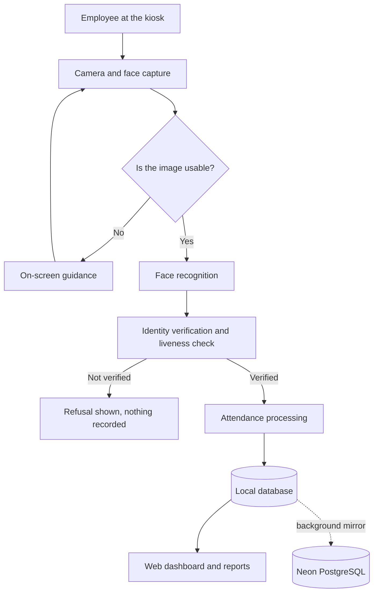
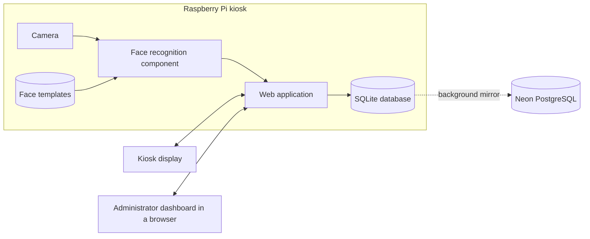

<<<<<<< HEAD
# FaceTap
=======

# FaceTap

**Face-recognition attendance for schools and small organizations**

[Overview](#overview) · [Workflow](#facial-recognition-attendance-workflow) · [Architecture](#system-architecture) · [Documentation](#documentation) · [Status](#current-project-status)

> **This repository contains public documentation for FaceTap only. The application source code is maintained separately in a private repository.**
>
> Public access to this documentation does not grant access to, or permission to reuse, the private FaceTap source code.

<strong>How to read this documentation</strong>

| Marker | Meaning |
|---|---|
| No marker | Confirmed against the private codebase when this documentation was last reviewed |
| **Suggested** | A recommendation or a possible direction, not a description of what exists |
| `[TO CONFIRM: ...]` | A placeholder that the project team still needs to fill in or verify |

Last reviewed: 6 November 2026.

---

## Overview

FaceTap is a web-based attendance system built around a camera kiosk. A person stands in front of the kiosk, the system identifies them from their face, and their Time-In or Time-Out is recorded. Administrators and HR staff use a browser-based dashboard to manage employees and schedules, review attendance, correct records and produce reports.

The kiosk runs on a Raspberry Pi and keeps recording when the network is down, because it stores every record on the device first and copies it to a Neon PostgreSQL database in the background.

## Problem statement

Attendance in schools and small organizations is often kept with paper logbooks, ID cards or manual encoding. These methods have well-known weaknesses:

- Records can be written or tapped on another person's behalf.
- Paper logs take time to consolidate into hours and reports.
- Errors are often found only when records are reviewed, long after the day in question.
- Corrections can leave no trace of who changed what, or why.

FaceTap aims to reduce these problems by tying each attendance event to a face scan, computing the day's result from the employee's own schedule, and keeping an audit trail of changes.

## Objectives

1. Record Time-In and Time-Out through hands-free face recognition at a kiosk.
2. Keep attendance recording available during network outages.
3. Give authorized staff a dashboard for monitoring, correcting and reporting attendance.
4. Evaluate each day against the employee's schedule, the school calendar and approved leave.
5. Protect biometric and personal data through access control and careful storage.

## Main features

| Area | What FaceTap provides |
|---|---|
| **Attendance** | Hands-free Time-In and Time-Out, one record per employee per day, and on-screen results |
| **Face recognition** | Face detection, identification, on-screen positioning guidance and a mandatory liveness check |
| **Employees** | Employee records and face enrollment from a camera |
| **Scheduling** | Weekly schedules per employee, and a school calendar |
| **Leave and Official Business** | Digital forms, printable forms and approvals |
| **Reports** | Filtered attendance reports, PDF exports, an attendance summary and statistics |
| **Administration** | Role-based accounts, settings, branding, backups and an activity log |

See [docs/features.md](docs/features.md) for the full list.

## How the system works

1. **Enrollment.** Authorized staff register an employee and capture face samples.
2. **Presenting.** The employee stands in front of the kiosk camera. If something needs fixing, the screen says so (for example, "Move closer").
3. **Verification.** The system checks the image, identifies the person and runs a liveness check.
4. **Recording.** If verification succeeds, a Time-In or Time-Out is saved on the device, and the screen shows the result.
5. **Waiting.** The kiosk waits for that person to leave before scanning again, so one person standing there is not recorded repeatedly.
6. **Mirroring.** A background process copies the record to the Neon PostgreSQL database.
7. **Reviewing.** Staff see the records on the dashboard, correct them where needed and generate reports.

Face recognition can fail or make mistakes. FaceTap has procedures for when it does: staff can correct a record or enter one by hand, and each such change is recorded with a reason.

## Facial recognition attendance workflow

## Technology stack

| Layer | Technology |
|---|---|
| Language | Python 3.11 or newer |
| Web application | Flask, with Jinja templates |
| User interface | HTML, CSS and JavaScript |
| Application server | Gunicorn |
| Face detection and recognition | OpenCV, with the YuNet and SFace models |
| Liveness check | MiniFASNetV2 model, run through OpenCV |
| On-device database | SQLite |
| Cloud database | Neon PostgreSQL |
| Camera access | Picamera2 for Raspberry Pi camera modules, OpenCV for USB cameras |
| Reports | ReportLab (PDF) |
| Password hashing | Argon2id |

## Neon/PostgreSQL database

FaceTap uses [Neon](https://neon.tech/), a hosted PostgreSQL service, as its cloud database. It works alongside a SQLite database on the device:

| Database | Role |
|---|---|
| **SQLite, on the device** | The working database. The application reads from it and writes to it directly, so a slow or lost connection does not delay a scan. |
| **Neon PostgreSQL, in the cloud** | A mirror of the device's records, updated by a background process. Changes wait on the device during an outage and are sent once the connection returns. |

The connection to the cloud database is encrypted, and its credentials are kept in private configuration. Face templates are not sent to the cloud database.

## Raspberry Pi integration

The Raspberry Pi is the kiosk itself. It runs the web application and the face-recognition pipeline, holds the on-device database and face templates, and drives the kiosk display. Because this work happens on the device, recording attendance does not need an internet connection.

## Camera integration

- Raspberry Pi camera modules are supported through Picamera2, and USB webcams through OpenCV.
- The camera feeds the live preview at the kiosk and the check that a person is in position.
- Camera frames are processed on the device.
- For enrollment, authorized staff can also use the camera of the device they are signed in on.

## Web dashboard

Staff use the dashboard from any device with a modern browser. It provides an attendance overview, management screens, reports and system status. What each person can see depends on their role, and permissions are checked on the server.

## Attendance management

- One attendance record per employee per day, with Time-In and Time-Out
- Daily status worked out from the employee's schedule, the school calendar and approved leave
- A configurable grace period
- Corrections and manual entries, each with a required reason

## Employee and user management

- Employee records, including activation and deactivation
- Face enrollment by authorized staff, and removal of an employee's face data
- Weekly schedules, set on screen or imported from a spreadsheet
- Staff accounts with three roles: Admin, HR and Kiosk

Employees do not need an account to record attendance at the kiosk.

## Reports

- Attendance reports filtered by date and employee
- PDF exports
- An attendance summary, which can be exported for payroll use
- Attendance statistics
- Leave and Official Business records with printable copies

## System architecture

The kiosk does not depend on the network to record attendance. Face templates stay on the device and are not sent to the cloud database.

See [docs/system-architecture.md](docs/system-architecture.md).

## Hardware requirements

| Component | Purpose |
|---|---|
| Raspberry Pi | Runs the application and the face-recognition pipeline |
| Camera | Captures faces at the kiosk |
| Display | Shows the live preview, guidance and results at the kiosk |
| Network connection | Used for cloud mirroring, email and remote administration |
| Power supply | Powers the kiosk |
| Admin computer | Any device with a browser, for the dashboard |

See [docs/hardware-requirements.md](docs/hardware-requirements.md).

## Software requirements

A Linux-based operating system on the Raspberry Pi, Python 3.11 or newer, the packages listed under [Technology stack](#technology-stack), and a modern browser for the kiosk and dashboard. The Neon PostgreSQL mirror is optional: without it, data stays on the device.

Full installation instructions are maintained internally. See [docs/software-requirements.md](docs/software-requirements.md) and [docs/installation-overview.md](docs/installation-overview.md).

## Screenshots

> Screenshots are pending. They must show test data only: see [screenshots/README.md](screenshots/README.md).

| Screen | Planned file | Status |
|---|---|---|
| Login page | `screenshots/login-page.png` | Pending |
| Administrator dashboard | `screenshots/admin-dashboard.png` | Pending |
| Attendance monitoring | `screenshots/attendance-monitoring.png` | Pending |
| Employee management | `screenshots/employee-management.png` | Pending |
| Attendance report | `screenshots/attendance-report.png` | Pending |

<!-- Once the image files exist, delete the table above and remove these comment markers:

| Login | Dashboard |
|---|---|
|  |  |

| Attendance monitoring | Employee management | Attendance report |
|---|---|---|
|  |  |  |

-->

## Security and privacy considerations

Face data is sensitive personal information. In summary:

- Face templates are stored on the kiosk device, outside the web root, and are reachable only through routes that check authorization first.
- Accounts use role-based access control, enforced on the server, and passwords are hashed with Argon2id.
- Corrections and other administrative actions are written to an activity log.
- Recognition and the liveness check reduce the risk of misuse, but they do not eliminate it.

An institution deploying FaceTap is responsible for its own legal review, consent process and retention policy. This project makes no claim of compliance with any specific law or standard.

See [docs/security-and-privacy.md](docs/security-and-privacy.md).

## Current project status

| Item | Status |
|---|---|
| Current version | `[TO CONFIRM: version number]` |
| Development status | `[TO CONFIRM: for example, capstone prototype or pilot]` |
| Recognition accuracy | Not published. No formal evaluation results are available yet. |

See [docs/project-status.md](docs/project-status.md).

## Future improvements

**Suggested** directions, none of them commitments:

- A formal evaluation of recognition accuracy across more people and lighting conditions
- Wider testing of the liveness check against printed photos and replayed video
- A documented retention schedule for attendance and biometric data
- Further Leave and Official Business workflow improvements

## Documentation

| Document | Contents |
|---|---|
| [System overview](docs/system-overview.md) | Purpose, intended users, components and general workflow |
| [Features](docs/features.md) | Features by category |
| [System architecture](docs/system-architecture.md) | High-level structure and data flow |
| [Hardware requirements](docs/hardware-requirements.md) | What a kiosk needs |
| [Software requirements](docs/software-requirements.md) | The software stack |
| [Installation overview](docs/installation-overview.md) | High-level deployment steps |
| [Security and privacy](docs/security-and-privacy.md) | How data is protected, and responsible use |
| [Project status](docs/project-status.md) | Version, progress and known limitations |

## Source code notice

The FaceTap application source code is maintained in a private repository and is not part of this repository. Access is at the discretion of the project owner. `[TO CONFIRM: how evaluators or collaborators can request access]`

**Public access to this documentation does not grant access to, or permission to reuse, the private FaceTap source code.** No part of the application may be copied, distributed or reused on the basis of this documentation.

## Project team

| Name | Role |
|---|---|
| `[TO CONFIRM: name]` | `[TO CONFIRM: role]` |
| `[TO CONFIRM: name]` | `[TO CONFIRM: role]` |

Contact: `[TO CONFIRM: a public contact address, if you want one]`

Academic context: `[TO CONFIRM: institution, degree program, course, adviser and academic year, if this is a capstone or thesis project]`

## License

No open-source license has been chosen. See [LICENSE](LICENSE). Third-party components used by FaceTap remain under their own licenses.

## Disclaimer

FaceTap is an academic software project. Face recognition is not perfectly accurate and can be affected by lighting, camera position, changes in appearance and other factors. Attendance records should remain subject to human review, and a person should have a way to get a wrong record corrected.

This documentation is provided for information only and is not legal advice. It describes the system as of its last review and may not reflect later changes.
>>>>>>> 701e677 (Initial FaceTap public documentation)
