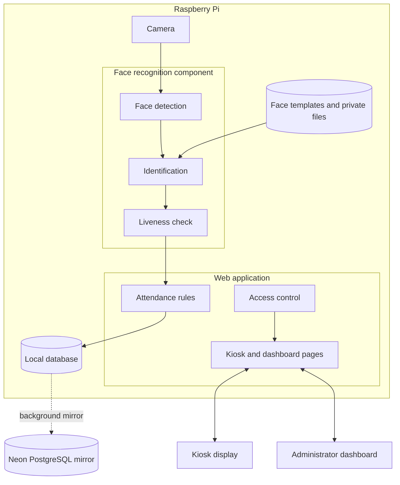
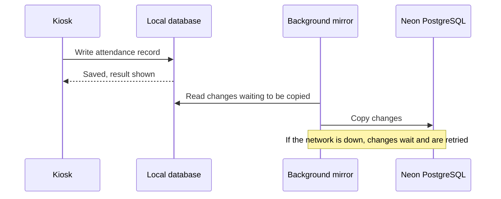

# System Architecture

[Back to README](../README.md)

This page describes FaceTap's structure at a high level. Source code, network details and deployment settings are deliberately left out.

## Components

## Local-first storage

The application always reads and writes a local database. A background process copies records to a Neon PostgreSQL database in the cloud, and catches up after an outage.

This approach has trade-offs:

- **Benefit:** a lost connection does not stop anyone recording attendance.
- **Benefit:** the cloud copy can help rebuild the database if the device fails.
- **Cost:** the cloud copy can lag behind the device while it is offline.

Without a cloud database configured, all data stays on the device, and backups are the only other copy.

## What is stored where

| Data | On the device | In the cloud mirror |
|---|---|---|
| Employee and attendance records | Yes | Yes, if configured |
| Leave, Official Business and approvals | Yes | Yes, if configured |
| Accounts, including password hashes | Yes | Yes by default, if configured |
| Face templates and uploaded files | Yes | No. They are included in device backups instead, and an encrypted copy can be produced for off-device storage. |

## The scan process

1. The camera provides live frames to the preview and to the position check.
2. Once the person is in position, the web application asks the face recognition component to verify them.
3. Recognition runs in a separate process, which has no access to the camera or the attendance data. This lets the application stop it if it takes too long.
4. Only a verification issued by the server can lead to an attendance record. Nothing the browser sends can stand in for it.
5. The verification is used once, and the record is then written.

## Access boundaries

- Every page and API route checks the account's role on the server.
- The Kiosk role can reach the attendance terminal and nothing else.
- Face data and uploaded files sit outside the public web folder.

See [Security and Privacy](security-and-privacy.md).

## Single-device design

Scan state is held per camera, and the supported deployment runs one camera per application instance. `[TO CONFIRM: whether more than one kiosk is planned]`
